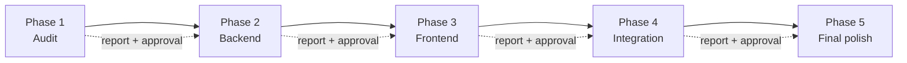
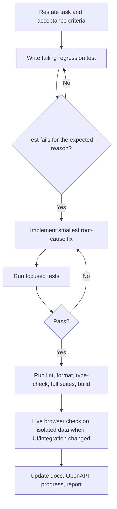
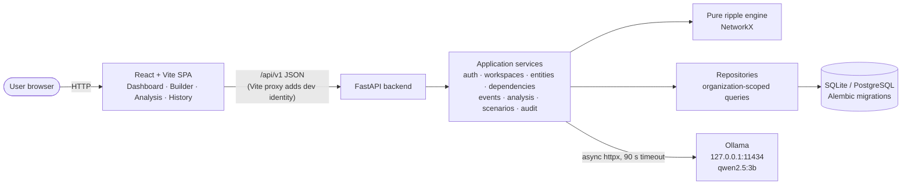
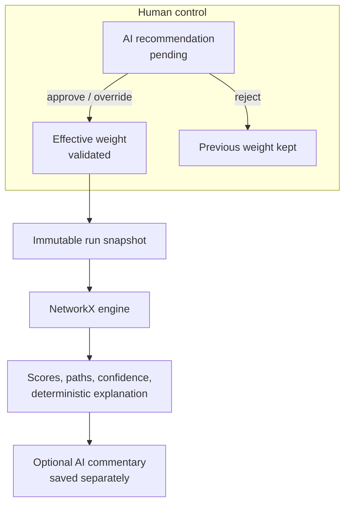
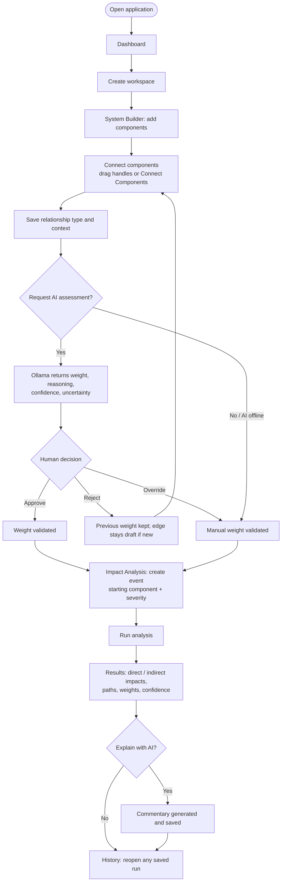
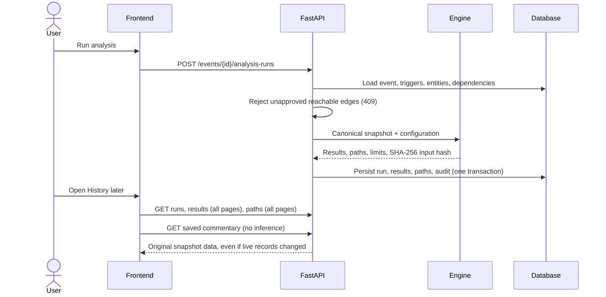
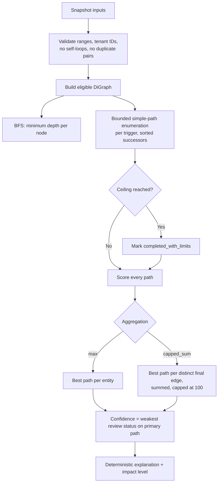
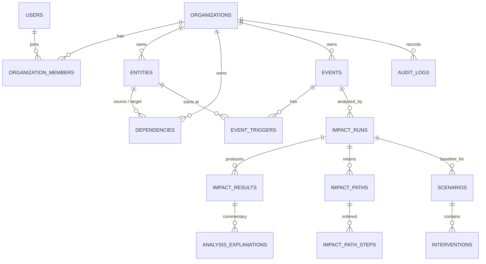

# Ripple Effect — Project Manual

Version: product-improvement release, 2026-11-20 · Branch: `project`

This manual describes the implemented application. Where behaviour is planned,
partial, or unverified, it is labelled. Scores are heuristic estimates, never
probabilities.

## Contents

1. [Overview](#1-overview)
2. [Core concepts](#2-core-concepts)
3. [Software and technology stack](#3-software-and-technology-stack)
4. [Development methodology](#4-development-methodology)
5. [System architecture](#5-system-architecture)
6. [User workflow and flowcharts](#6-user-workflow-and-flowcharts)
7. [How the impact engine works](#7-how-the-impact-engine-works)
8. [How AI assistance works](#8-how-ai-assistance-works)
9. [Data model and persistence](#9-data-model-and-persistence)
10. [Security, tenancy, and auditing](#10-security-tenancy-and-auditing)
11. [API reference](#11-api-reference)
12. [Frontend guide](#12-frontend-guide)
13. [Edge cases and how they are handled](#13-edge-cases-and-how-they-are-handled)
14. [Installation and running](#14-installation-and-running)
15. [Configuration reference](#15-configuration-reference)
16. [Testing and quality gates](#16-testing-and-quality-gates)
17. [Troubleshooting](#17-troubleshooting)
18. [Repository structure](#18-repository-structure)
19. [Known limitations](#19-known-limitations)
20. [Future implementations](#20-future-implementations)
21. [Glossary](#21-glossary)

---

## 1. Overview

Ripple Effect is an AI-assisted dependency mapping and impact analysis
platform. It answers one question: **when one component of a system is
disrupted, which connected components may be affected, how strongly, and why?**

The product is general-purpose. A user can model software infrastructure,
business workflows, supply chains, hospital services, or any system of
interdependent components. Nothing is hardcoded to one domain, and fresh
installations start with no workspaces.

The core principle:

> **AI understands relationships and recommends weights. Humans approve them.
> Graph theory determines how disruptions propagate. The application explains
> the result.**

| Responsibility | Owner |
|---|---|
| Defining components and dependencies | User |
| Recommending dependency weights, with reasoning and uncertainty | Local AI (Ollama, `qwen2.5:3b`) |
| Approving, rejecting, or overriding weights | User |
| Calculating propagation and impact scores | Deterministic NetworkX engine |
| Explaining results | Deterministic engine explanation, plus optional saved AI commentary |
| Preserving history | Immutable run snapshots in the database |

## 2. Core concepts

| Concept | Meaning |
|---|---|
| **Workspace** | A user-created system. Technically an organization; all records are scoped to it. |
| **Component (entity)** | A node: name, description, type, status, category, criticality, and position. |
| **Dependency** | A directed edge **source → target**: a disruption in the source may affect the target. |
| **Weight** | 0–1 strength of propagation along a dependency. 1 means full propagation before attenuation. |
| **Review status** | `draft` (unapproved), `reviewed`, or `validated` (explicitly approved or manually set). |
| **Event / trigger** | A disruption with a severity (0–100) applied to a starting component. |
| **Analysis run** | One deterministic calculation over an immutable snapshot of inputs. |
| **Direct impact** | Components one dependency away from the trigger (minimum depth 1). |
| **Indirect impact** | Components two or more dependencies away (minimum depth ≥ 2). |
| **Confidence** | Quality of dependency review on the primary path — not likelihood. |

Direction is never inverted. `Database → Backend API` means the Backend API
depends on the Database, so a database outage may affect the API.

## 3. Software and technology stack

| Layer | Technology | Role |
|---|---|---|
| Frontend | React 19, TypeScript 6, Vite 8 | Single-page application |
| Graph UI | `@xyflow/react` (React Flow) 12 | Interactive builder and result graphs |
| Frontend tests | Vitest, Testing Library, Playwright | Unit/component and real-browser tests |
| Frontend quality | ESLint, Prettier | Linting and formatting |
| Backend | Python ≥ 3.11 (verified on 3.14.7), FastAPI, Uvicorn | REST API |
| Validation | Pydantic 2 | Request/response schemas and AI output validation |
| Persistence | SQLAlchemy 2, Alembic | ORM and migrations |
| Database | SQLite (local/tests), PostgreSQL (intended authoritative store) | Storage |
| Graph engine | NetworkX | Directed graph construction and traversal |
| AI runtime | Ollama v0.40.16, `qwen2.5:3b` (Q4_K_M) | Local, loopback-only inference |
| HTTP client | httpx (async) | Non-blocking calls to Ollama |
| Backend quality | pytest, Ruff | Tests, linting, formatting |
| Packaging | uv (Python), npm (Node) | Locked dependency installation |
| Delivery (optional) | Docker, Compose, Nginx, Bicep, Kubernetes, Jenkins | Prepared; not the current priority |

No paid AI service is used. All dependencies are pinned through `uv.lock` and
`package-lock.json`.

## 4. Development methodology

The project follows an evidence-driven, phase-gated process.

### 4.1 Principles

- **Phase gates.** Work proceeds one approved phase at a time. Each phase ends
  with a report and stops until a human explicitly approves the next.
- **Tests first for logic.** Graph, authorization, and AI-validation changes
  begin with a failing regression test, then the smallest fix.
- **Root-cause fixes.** Failing checks are never suppressed, thresholds are not
  lowered, and timeouts are not raised to manufacture a pass.
- **Evidence integrity.** Only executed results are reported. Mocked AI output
  is confined to automated tests. Missing human evidence is marked TODO(human).
- **Data safety.** Acceptance tests use fresh isolated SQLite files. Original
  databases are never reset, migrated, or seeded during verification.
- **Incremental change.** Working features are preserved; there are no large
  rewrites. The original blue theme and ripple background are retained.

### 4.2 Improvement phases



| Phase | Outcome |
|---|---|
| 1. Audit | Baseline tests, gap list, and brief/code conflicts recorded |
| 2. Backend | Persistent AI commentary, context-aware approvals, enriched snapshots |
| 3. Frontend | Full pagination, saved-commentary history, clearer graph roles, responsive layout |
| 4. Integration | Genuine local Qwen verification, restart persistence, commentary grounding fixes |
| 5. Polish | Green quality gates, empty-install defaults, builder layout, documentation |

Per-phase reports are in [`docs/reports/`](reports/), and the running handoff is
[`docs/progress.md`](progress.md).

### 4.3 Per-task workflow



## 5. System architecture

### 5.1 Container view



### 5.2 Layer responsibilities

| Layer | Location | Responsibility |
|---|---|---|
| Presentation | `frontend/src/App.tsx`, `styles.css` | Workflows, graph rendering, states, accessibility |
| Typed API client | `frontend/src/api.ts` | Requests, error envelopes, complete pagination |
| HTTP routes | `backend/app/api.py`, `main.py` | Authenticate, authorize, validate, delegate, error handling |
| Services | `services.py`, `analysis_service.py`, `scenario_service.py` | Use cases, transactions, audit records |
| Engine | `engine.py` | Pure deterministic analysis; no FastAPI, SQLAlchemy, or AI imports |
| AI adapter | `ai_service.py` | Prompts, structured output validation, timeouts, error mapping |
| Persistence | `models.py`, `repositories.py`, `migrations/` | Schema, tenant constraints, scoped queries |
| Auth | `auth.py`, `local_account.py` | Membership resolution, role permissions, local dev identity |

Dependency direction is strict: presentation → API → services → engine/repositories.
The engine runs in unit tests without a database or HTTP server.

### 5.3 Separation of AI and calculation



AI output never enters the score calculation unless a human has approved it as
a dependency weight. Commentary reads saved results; it never changes them.

## 6. User workflow and flowcharts

### 6.1 End-to-end workflow



### 6.2 Weight assessment sequence

```mermaid
sequenceDiagram
    actor U as User
    participant FE as Frontend
    participant API as FastAPI
    participant DB as Database
    participant AI as Ollama
    U->>FE: Request AI assessment
    FE->>API: POST /dependencies/{id}/assessment
    API->>DB: Load dependency, endpoints, workspace (scoped)
    API->>API: Build context; release transaction
    API->>AI: Structured JSON-schema chat request
    AI-->>API: weight, reasoning, confidence, uncertainty
    API->>API: Validate output (range, non-blank, enum)
    API->>DB: Re-check timestamp and context; save as pending + audit
    API-->>FE: Dependency with pending assessment
    U->>FE: Approve / Reject / Manual weight
    FE->>API: POST /dependencies/{id}/assessment/decision
    API->>DB: Verify context unchanged; set effective weight; audit
```

### 6.3 Analysis and history sequence



## 7. How the impact engine works

### 7.1 Graph construction

The system is a directed weighted graph **G = (V, E, W)**:

- **V** — non-archived components in the snapshot.
- **E** — eligible dependencies: active, both endpoints present, inside their
  validity window at `as_of`, weight ≥ `min_edge_weight`.
- **W** — approved weights in `[0, 1]`.

Edges are added in sorted order so identical inputs always produce identical
results.

### 7.2 Scoring formula

For a trigger component and a simple path of *k* edges:

$$
\text{trigger\_score} = \text{severity} \times \text{exposure}_t \times (1 - m_t)
$$

$$
\text{path\_score} = \text{trigger\_score} \times \prod_{i=1}^{k} \left( w_i \times d \times (1 - m_{v_i}) \right)
$$

| Symbol | Meaning | Default |
|---|---|---|
| severity | Event severity, 0–100 | user input |
| exposure_t | Trigger exposure, 0–1 | 1.0 |
| m_t, m_vᵢ | Mitigation of the trigger / entered node, 0–1 | 0 |
| wᵢ | Approved weight of edge *i* | user/AI approved |
| d | Depth attenuation per edge | 0.8 |

### 7.3 Worked example

`Database → Backend API → Frontend Application`, severity 90, approved weights
1.0 and 0.5, no mitigation:

| Component | Calculation | Score | Role |
|---|---|---|---|
| Database | 90 | 90.0 | Starting entity (depth 0) |
| Backend API | 90 × 1.0 × 0.8 | 72.0 | Direct impact (depth 1) |
| Frontend Application | 72 × 0.5 × 0.8 | 28.8 | Indirect impact (depth 2) |

These values were observed in the genuine-AI acceptance run; they follow from
inputs and are not hardcoded.

### 7.4 Traversal, aggregation, and confidence



- **Simple paths only.** A path never revisits a node, so cycles are safe.
- **Bounds.** `max_depth` 4 (1–10), `max_paths_per_trigger` 10,000,
  `max_nodes_per_run` 5,000. Reaching a ceiling gives `completed_with_limits`.
- **Ties.** Fewer edges first, then lexicographic entity/dependency IDs.
- **Impact levels.** low < 25 ≤ moderate < 50 ≤ high < 75 ≤ critical.
- **Confidence.** draft 0.5 low, reviewed 0.8 medium, validated 1.0 high.
- **Reproducibility.** A canonical JSON snapshot is hashed with SHA-256 and
  stored. Replaying the snapshot reproduces the same output.

## 8. How AI assistance works

### 8.1 Weight recommendation

The backend sends Ollama a JSON context:

- workspace name and description;
- source and target names, descriptions, categories, status, metadata;
- explicit direction ("target depends on source");
- relationship type, label, and user context.

Ollama must return a JSON object matching a schema:

| Field | Validation |
|---|---|
| `recommended_weight` | Strict number, 0–1 (rejects strings, booleans, NaN) |
| `reasoning` | Required, non-blank after trimming |
| `confidence` | `low`, `medium`, or `high` |
| `uncertainty` | Required, non-blank |
| `assumptions`, `missing_information` | Lists, at most 20 items |

Invalid output is rejected (HTTP 502). The recommendation is saved as
**pending** with its input context and never changes the effective weight until
a human decides.

### 8.2 Commentary

"Explain with AI" sends only persisted data: event, named trigger entities,
the selected result's score, band, confidence, and retained paths. The prompt
asks for at most 90 words in three headed sections (Actual Impact, Propagation
Reason, Possible Improvements), forbids inventing scores or resources, and
labels improvements as requiring human review.

Commentary is appended to `analysis_explanations` with the exact context,
model, run hash, author, and time. History reopens it with a GET request that
never calls Ollama.

### 8.3 Local runtime

Ollama binds to `127.0.0.1:11434` with cloud features disabled. Inference is
asynchronous; no database transaction is held while the model runs. On the
CPU-only verification machine, assessments took about 50 seconds and commentary
about 55 seconds, within the 90-second timeout.

## 9. Data model and persistence



| Table | Key contents |
|---|---|
| `organizations` | Workspace name and description |
| `users`, `organization_members` | Identity subject, role, membership status |
| `entities` | Name, type, status, exposure, mitigation, metadata (category, criticality, position) |
| `dependencies` | Source, target, relationship, weight, review status, assessment JSON, validity window |
| `events`, `event_triggers` | Title, severity, start time, status; trigger entity and rationale |
| `impact_runs` | Status, configuration, immutable `input_snapshot`, `input_hash`, algorithm version |
| `impact_results`, `impact_paths`, `impact_path_steps` | Scores, depth, confidence, explanation, provenance |
| `analysis_explanations` | Append-only AI commentary with context and run hash |
| `scenarios`, overrides, `interventions` | Isolated hypothetical overlays |
| `audit_logs` | Actor, action, resource, request ID, summary |

**Migrations:** `b4fceea3f1e2` (foundation) → `c13a4f8d2b71` (run snapshot) →
`e52c93d6b018` (workspace description, assessments) → `f64d81a2c039`
(commentary). Migrations are additive and tested for upgrade, downgrade, and
schema drift.

**History guarantee:** a run stores its complete input snapshot, including
descriptive and assessment context. Renaming a component or changing a weight
afterwards does not alter saved runs.

## 10. Security, tenancy, and auditing

- **Tenant isolation.** Every tenant-owned row has `organization_id`. Composite
  foreign keys such as `(entity_id, organization_id)` make cross-workspace
  references impossible at the database level.
- **Visibility.** Non-members get **404** (existence is not revealed); members
  without permission get **403**.
- **Roles.**

| Permission | Administrator | Operations coordinator | Department coordinator | Analyst |
|---|:-:|:-:|:-:|:-:|
| Read model/events/results | ✓ | ✓ | ✓ | ✓ |
| Write entities, dependencies, events | ✓ | ✓ | – | – |
| Request/decide AI assessments | ✓ | ✓ | – | – |
| Run analyses and scenarios | ✓ | ✓ | – | ✓ |
| Manage workspace/members, read audit | ✓ | – | – | – |

- **Audit.** State changes, analysis runs, assessments, decisions, and commentary
  write audit records in the same transaction.
- **Concurrency.** Updates carry `expected_updated_at`; stale writes get 409.
- **Local authentication.** `X-Local-User-ID` works only when `APP_ENV` is
  `development` or `test` **and** `ENABLE_LOCAL_AUTH=true`. It is not
  production authentication.
- **AI safety.** Graph text is treated as untrusted data in prompts; Ollama is
  loopback-only; no data leaves the machine.

## 11. API reference

All routes are under `/api/v1`; the reviewed contract is
[`docs/api/openapi.json`](api/openapi.json), and live docs are at `/docs`.
Collections accept `limit` (1–100) and `offset`, returning
`{items, limit, offset, total}`. Errors use one envelope:
`{"error": {code, message, details, request_id}}`.

| Area | Endpoints |
|---|---|
| Health | `GET /health/live`, `GET /health/ready` |
| Workspaces | `GET /workspaces`, `POST /workspaces`, `PATCH /workspaces/current`, `GET /workspace-dashboard` |
| Entities | `GET/POST /entities`, `GET/PATCH/DELETE /entities/{id}` (delete archives) |
| Dependencies | `GET/POST /dependencies`, `GET/PATCH /dependencies/{id}`, `PATCH /dependencies/{id}/activation` |
| AI assessment | `POST /dependencies/{id}/assessment`, `POST /dependencies/{id}/assessment/decision` |
| Events | `GET/POST /events`, `GET/PATCH /events/{id}`, `PATCH /events/{id}/status` |
| Triggers | `GET/POST /events/{id}/triggers`, `DELETE /events/{id}/triggers/{trigger_id}`; `POST /trigger-events`, `PATCH /trigger-events/{id}` (combined form) |
| Analysis | `POST /events/{id}/analysis-runs`, `GET /analysis-runs`, `GET /analysis-runs/{id}` |
| Results | `GET /analysis-runs/{id}/results`, `.../results/{entity_id}`, `.../results/{entity_id}/paths` |
| Commentary | `POST /analysis-runs/{id}/ai-explanation` (generate + save), `GET /analysis-runs/{id}/ai-explanation?entity_id=` (saved only) |
| Scenarios | `POST/GET /scenarios`, `GET/PATCH/DELETE /scenarios/{id}`, `PATCH .../event`, `POST .../interventions`, `POST .../analysis-runs`, `GET .../comparison` |

Analysis request body (all optional):

```json
{
  "as_of": "2026-11-20T12:00:00Z",
  "max_depth": 4,
  "min_edge_weight": 0.0,
  "depth_attenuation": 0.8,
  "aggregation": "max",
  "max_paths_per_trigger": 10000,
  "max_nodes_per_run": 5000,
  "include_trigger_entities": true
}
```

## 12. Frontend guide

| Section | What the user does |
|---|---|
| **Dashboard** | Sees workspace, component, approved-dependency, and saved-run counts; creates or opens a workspace |
| **System Builder** | Adds and edits components; connects them by dragging handles or **Connect Components**; requests AI assessments; approves, rejects, or enters manual weights; drags nodes (positions are saved) |
| **Impact Analysis** | Creates a trigger with name, description, context, starting component, and severity; runs analysis; inspects results |
| **History** | Reopens saved runs exactly as calculated, with saved commentary |

Visual conventions:

- Builder edges show the weight, or **Needs review** with a dashed line for drafts.
- Unsaved builder layouts flow left to right by dependency level; dragged
  positions take priority.
- Result nodes show name, role, score, and band. Starting entities have a double
  border, direct impacts a solid border, indirect impacts a dashed border.
  Colour is never the only cue.
- Selecting a result node opens its details. Each detail lists paths, weights,
  the deterministic explanation, review confidence, and AI commentary.
- On narrow screens the result graph switches to a vertical layout. Zoom and fit
  controls are always available.

## 13. Edge cases and how they are handled

### 13.1 Graph and calculation

| Case | Behaviour |
|---|---|
| Cycle (A → B → A) | Simple-path enumeration never revisits a node; terminates safely |
| Disconnected component | Not reachable, so not in results |
| Reverse dependency | Direction is never inverted; target → source does not propagate |
| Multiple paths to one node | `max` keeps the strongest; `capped_sum` sums best path per final edge, capped at 100; all retained paths stored |
| Same path reachable from two triggers | Deduplicated by entity and dependency ID sequence |
| Longer path scores higher | Primary path may be longer than minimum depth; explanation says so |
| Equal scores | Fewer edges, then lexicographic IDs |
| Very large or dense graph | Depth, path, and node ceilings; run marked `completed_with_limits` |
| Zero-weight edge | Kept in the model; excluded from live analysis |
| Inactive dependency or archived component | Excluded from the graph |
| Dependency outside validity window | Excluded (start inclusive, end exclusive) |
| Attenuation 0 | Downstream paths remain with zero scores |
| Draft edge reachable from trigger | Analysis rejected with 409 listing the edges to approve |

### 13.2 Data and API

| Case | Behaviour |
|---|---|
| Self-loop dependency | Rejected (422; database check constraint) |
| Duplicate source → target | Rejected with 409 |
| Cross-workspace reference | Database composite FK rejects; API returns 404 |
| Concurrent edit | Stale `expected_updated_at` returns 409 |
| Event not open / no trigger | Analysis returns 409 |
| Invalid ranges (weight, severity) | 422 with field details |
| Engine failure | Run saved as `failed` with a diagnostic ID, audited; no internal details exposed |
| Live records change after a run | Saved snapshot, results, and History are unchanged |
| Collections larger than one page | Frontend collects all pages; a non-advancing page shows an error instead of truncating |

### 13.3 AI

| Case | Behaviour |
|---|---|
| Ollama offline or timed out | 503 with guidance to retry or enter a manual weight; analysis and history remain usable |
| Model missing or malformed output | 502; nothing saved |
| Weight outside 0–1, string, boolean, NaN, blank reasoning | Rejected by validation |
| Components or workspace changed after assessment | Approval returns 409; reassessment required |
| Reassessment or rejection of an approved edge | Existing effective weight preserved |
| Commentary regeneration fails | Saved commentary stays visible; error shown locally |
| Model mislabels components | Prompt grounds output in named triggers and the selected band; human review label shown |

## 14. Installation and running

### 14.1 Prerequisites

- Windows, macOS, or Linux with Node.js (≥ the Vite 8 requirement), npm, Python
  ≥ 3.11, and [uv](https://docs.astral.sh/uv/).
- Ollama with `qwen2.5:3b` for AI features. About 2 GB disk for the model; 8 GB
  RAM is workable but slow on CPU.
- Optional: Google Chrome for Playwright acceptance tests.

### 14.2 Start Ollama

```powershell
ollama pull qwen2.5:3b
ollama serve        # or start the Ollama desktop application
```

A checksum-verified, workspace-local portable setup is documented in
[`docs/runbooks/local-ollama-portable.md`](runbooks/local-ollama-portable.md).

### 14.3 Start the backend (terminal 1)

```powershell
cd backend
uv sync --locked
$env:APP_ENV = 'development'
$env:ENABLE_LOCAL_AUTH = 'true'
$env:DATABASE_URL = 'sqlite:///./ripple-local.sqlite3'
$env:OLLAMA_BASE_URL = 'http://127.0.0.1:11434'
$env:OLLAMA_MODEL = 'qwen2.5:3b'
uv run alembic upgrade head
uv run python -m app.local_account     # prints a user UUID
uv run uvicorn app.main:app --host 127.0.0.1 --port 8020
```

Back up any existing database before running `alembic upgrade head`.

### 14.4 Start the frontend (terminal 2)

```powershell
cd frontend
npm ci
$env:RIPPLE_LOCAL_USER_ID = '<UUID printed by app.local_account>'
$env:VITE_API_PROXY_TARGET = 'http://127.0.0.1:8020'
npm run dev -- --host 127.0.0.1 --port 5180 --strictPort
```

Open <http://127.0.0.1:5180>.

### 14.5 Quick demonstration script

1. **Create Workspace** → "Demo Infrastructure".
2. **System Builder** → add Database, Backend API, Frontend Application with
   descriptions and criticality.
3. Connect Database → Backend API and Backend API → Frontend Application.
   Save each relationship, **Request AI assessment**, read the reasoning, then
   **Approve weight** or enter a manual weight.
4. **Impact Analysis** → **Create trigger** "Database Outage", starting entity
   Database, severity 90 → **Run analysis**.
5. Expand results, follow paths, select graph nodes, use **Explain with AI**.
6. **History** → reopen the run; refresh the page to show persistence.

### 14.6 Optional: Docker Compose

```powershell
copy .env.example .env    # set a local-only password first
docker compose up --build
```

Compose runs PostgreSQL, the API, and Nginx on loopback ports. Demo data is off
unless `SEED_DEMO_DATA=true`. The production Nginx build has no development
identity injection, so the Vite workflow above is the supported local path.

## 15. Configuration reference

| Variable | Used by | Purpose / default |
|---|---|---|
| `APP_ENV` | Backend | `development`/`test` enable local features; defaults to `production` |
| `ENABLE_LOCAL_AUTH` | Backend | `true` enables the development identity header |
| `DATABASE_URL` | Backend, Alembic | SQLAlchemy URL (SQLite or `postgresql+psycopg://…`) |
| `OLLAMA_BASE_URL` | Backend | Default `http://localhost:11434` |
| `OLLAMA_MODEL` | Backend | Default `qwen2.5:3b` |
| `SEED_DEMO_DATA` | Container entrypoint | Opt-in synthetic fixtures; default `false` |
| `RIPPLE_LOCAL_USER_ID` | Vite dev proxy | Development identity injected as `X-Local-User-ID` |
| `VITE_API_PROXY_TARGET` | Vite dev proxy | API target; default `http://127.0.0.1:8000` |
| `VITE_API_BASE_URL` | Frontend | Optional API origin; same-origin by default |
| `POSTGRES_USER`, `POSTGRES_PASSWORD`, `POSTGRES_DB` | Compose | Local database credentials |
| `RIPPLE_RUN_LIVE_E2E` | Playwright | `1` enables live browser tests |
| `RIPPLE_E2E_URL` | Playwright | URL of the running app |
| `RIPPLE_E2E_MANUAL` | Playwright | `1` uses manual weights instead of Ollama |
| `PLAYWRIGHT_USE_CHROME` | Playwright | `1` uses installed Chrome |
| `RIPPLE_PERSISTENCE_BASELINE` | Playwright | Path to write/read restart evidence |
| `RIPPLE_VERIFY_RESTART` | Playwright | `1` runs the post-restart comparison |

## 16. Testing and quality gates

### 16.1 Commands

Backend (from `backend`):

```powershell
uv run pytest
uv run ruff check app tests scripts migrations
uv run ruff format --check app tests scripts migrations
```

Frontend (from `frontend`):

```powershell
npm test
npm run typecheck
npm run lint
npm run format:check
npm run build
```

Live browser acceptance (fresh isolated database required):

```powershell
$env:RIPPLE_RUN_LIVE_E2E = '1'
$env:RIPPLE_E2E_URL = 'http://127.0.0.1:5180'
$env:PLAYWRIGHT_USE_CHROME = '1'
$env:RIPPLE_VERIFY_RESTART = '0'
npm run test:e2e
```

After a run with `RIPPLE_PERSISTENCE_BASELINE` set, restart only the API on the
same database, then rerun with `RIPPLE_VERIFY_RESTART=1` and
`--grep 'externally performed API restart'`.

### 16.2 Test coverage areas

| Suite | Covers |
|---|---|
| `backend/tests/test_engine.py` | Direction, cycles, depth, scoring, aggregation, ties, confidence, limits, determinism, snapshot replay |
| `backend/tests/test_api.py` | CRUD, lifecycle, tenancy, roles, conflicts, audit, assessments, commentary persistence, OpenAPI contract |
| `backend/tests/test_ai_service.py` | Structured output validation, timeouts, unavailable/malformed responses, prompt safeguards |
| `backend/tests/test_tenancy.py`, `test_migrations.py`, `test_health.py` | Composite FKs, membership, migration round trip, PostgreSQL DDL, health |
| `frontend/src/*.test.ts(x)` | Pagination, saved commentary, graph roles, builder layout, error/retry states |
| `frontend/e2e/workflow.spec.ts` | Full user journey, genuine AI branch, responsive framing, offline assessment, restart persistence |

### 16.3 Latest verified results (2026-11-20)

| Gate | Result |
|---|---|
| Backend tests | 114 passed |
| Backend Ruff lint and format (full scope) | Passed |
| Frontend tests | 20 passed |
| ESLint, Prettier (full scope), production build | Passed |
| Genuine Qwen browser journey on fresh data | Passed (72.0 direct, 28.8 indirect) |
| Restart persistence with zero inference requests | Passed |
| `docker compose config`, standalone E2E type-check | Not run (Docker CLI and `@types/node` unavailable) |

## 17. Troubleshooting

| Symptom | Cause / fix |
|---|---|
| `ModuleNotFoundError: app` in pytest | Run from `backend`, or use `uv run --directory backend …` |
| Vitest "failed to find the current suite" | Run npm from the `frontend` directory, not via a lowercase-drive `--prefix` path |
| Prettier flags many files on Windows | Ensure `.gitattributes` LF rule is present; re-checkout or run `npx prettier --write` |
| "The local AI service is unavailable" | Start Ollama, confirm `curl http://127.0.0.1:11434/api/tags` lists `qwen2.5:3b`; manual weights still work |
| AI requests time out on CPU-only machines | Close memory-heavy apps; the 90 s limit is intentional; keep commentary concise |
| "Approve or override the weights for: …" | A reachable dependency is still draft; approve or enter a manual weight |
| 409 "context changed" on approval | Component or workspace changed since the assessment; request a new one |
| 401 "development account is not registered" | Run `python -m app.local_account` against the same database and use its UUID |
| Empty Dashboard on first launch | Expected: fresh installs start empty |
| Graph partly outside view | Use **Fit View**; layout refits on resize |

## 18. Repository structure

```text
ripple-effect/
├── backend/
│   ├── app/            api.py, main.py, auth.py, services.py, analysis_service.py,
│   │                   scenario_service.py, engine.py, ai_service.py, models.py,
│   │                   schemas.py, repositories.py, database.py, seed.py, local_account.py
│   ├── migrations/     Alembic environment and versions
│   ├── scripts/        export_openapi.py, smoke_compose.py
│   └── tests/          engine, API, AI, tenancy, migration, health suites
├── frontend/
│   ├── src/            App.tsx, api.ts, styles.css, RippleBackground.tsx, tests
│   └── e2e/            Playwright workflow
├── docs/               adr/, api/, architecture/, reports/, runbooks/, progress.md, viva-notes.md
├── infra/              azure/ (Bicep), phase10/ (Kubernetes, Jenkins)
├── docker-compose.yml, .env.example, AGENTS.md, README.md
```

Architecture decisions are recorded as ADRs in [`docs/adr/`](adr/).

## 19. Known limitations

- **Authentication.** Only local development identity exists; no production
  identity provider.
- **Scenarios in the UI.** Scenario overlays work in the backend and tested
  components, but the active frontend does not mount them.
- **PostgreSQL.** Offline DDL generation is tested; live PostgreSQL and
  concurrency are unverified.
- **Performance.** CPU-only inference is slow (≈50 s per assessment). Large-graph
  rendering is not benchmarked.
- **Model quality.** The 3B model can produce imperfect wording; commentary
  requires human review.
- **Licence.** `qwen2.5:3b` uses the Qwen Research License (non-commercial
  research/evaluation).
- **Commentary history.** Only the latest commentary per result is shown,
  although all generations are stored.
- **Brief differences awaiting decision.** Live `as_of` defaults to the current
  time rather than the event start; validity ends are exclusive; zero-weight
  edges are excluded from live runs.
- **Human evidence.** Interviews, Figma prototype, and usability testing are TODO(human).

## 20. Future implementations

| Priority | Item | Notes |
|---|---|---|
| High | Production authentication adapter (OIDC/JWT) | Validate tokens server-side; keep membership-derived roles |
| High | Mount scenario comparison in the UI | Backend and component exist; needs integration and tests |
| High | Resolve the three brief/code semantic differences | Record decisions as ADRs before changing replay behaviour |
| Medium | Live PostgreSQL verification and concurrency tests | Including Compose end to end |
| Medium | Background job queue for AI requests | Progress feedback for slow hardware |
| Medium | Commentary history browser | Show all saved generations with timestamps |
| Medium | CSV / printable export of runs | Include run ID, configuration, and "estimate, not probability" notice |
| Medium | CI/CD, image publishing, ACI deployment | Prepared in `infra/`; requires human cloud approval |
| Low | Bulk import of components and dependencies | CSV/JSON with validation |
| Low | Graph filtering and focus views for large systems | Subgraph around a selected node |
| Low | Alternative or larger local models | Validate quality and latency before switching |
| Low | Accessibility audit and user research | Replace hypotheses with real evidence |

## 21. Glossary

| Term | Definition |
|---|---|
| Attenuation | Per-edge reduction factor (default 0.8) |
| Capped sum | Aggregation summing distinct incoming best paths, capped at 100 |
| Canonical snapshot | Sorted, complete JSON of run inputs used for hashing and replay |
| Depth | Minimum number of edges from a trigger |
| Primary path | Highest-scoring retained path for an entity |
| Review status | Draft, reviewed, or validated quality of a dependency |
| Simple path | Path that visits no node twice |
| Tenant | A workspace (organization) and everything it owns |
